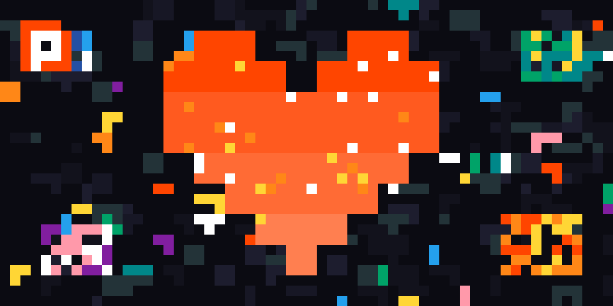

<div align="center">

# 🎨 PixelChain

**Une toile collaborative de 1 000 × 1 000 pixels, arbitrée par preuve de travail SHA-256.**

**Et l'histoire honnête d'un projet qui n'a pas atteint son objectif.**


**100 % local · 1 seule dépendance Python · 0 base de données · 0 service externe**

</div>

---

> [!WARNING]
> **Ce projet est inabouti — et je préfère l'écrire noir sur blanc.**
>
> PixelChain sait miner des pixels, les propager, trancher les conflits sur une même
> case et afficher une toile. Mais il ne sait pas **décider quel contenu doit entrer
> dans le bloc qui clôt une époque**. Chaque nœud construit son époque à partir des
> pixels qu'il a reçus en premier ; sous latence, ces ensembles diffèrent, et le bloc
> miné localement devient impossible à valider ailleurs. La preuve de travail sécurise
> un contenu… encore faut-il que tous les nœuds soient d'accord sur ce contenu.
>
> Une chaîne par pixel aurait réglé les conflits de case, mais pas la **cadence globale
> d'édition** que ce projet voulait imposer. Je n'ai pas de solution satisfaisante à ce
> jour ; les pistes que je n'ai pas explorées sont en bas de page.

## ✨ L'étincelle : r/place

<div align="center">
  <a href="https://www.reddit.com/r/place/">
    
  </a>
  <sub>
    L'étincelle : <a href="https://www.reddit.com/r/place/">r/place</a>.
    Illustration originale en hommage (SVG libre), avec le logo r/place du domaine public —
    ce n'est pas une capture officielle.
  </sub>
</div>

PixelChain est né d'une fascination pour **r/place** : cette toile géante où des
millions de personnes ont dessiné, recouvert, défendu et parfois saboté des pixels
pendant quelques jours. Ce qui m'intéressait n'était pas seulement le résultat, mais
le fait qu'une **œuvre collective émerge sans chef d'orchestre** : des communautés
négocient une place, des idées se diffusent, des références se superposent, et
l'histoire de ces négociations reste visible dans la matière même de la toile.

r/place est un événement éphémère, fermé par décision de la plateforme. PixelChain
voulait prolonger cette idée : une toile qui ne s'arrête pas, qui n'appartient à
personne, et dont l'histoire est **conservée par le protocole lui-même** plutôt que
par la bonne volonté d'une plateforme.

## 🎯 Le but

L'idée de départ tient en quatre promesses :

1. **Une toile unique, ouverte et sans autorité centrale.** 1 000 × 1 000 pixels RGB,
   modifiables par n'importe qui, sans compte, sans serveur officiel, sans base de
   données centrale.
2. **Une cadence globale, pas un free-for-all.** Le projet ne veut pas seulement
   arbitrer « qui gagne sur une case » : il veut imposer un **rythme d'édition commun
   à tout le réseau**. C'est le rôle des époques et du retarget de difficulté.
3. **Des conflits tranchés par le travail, pas par l'ordre d'arrivée.** Deux personnes
   qui peignent la même case doivent pouvoir départager leurs versions par la preuve
   de travail cumulée, de façon déterministe.
4. **Une mémoire collective, pas un flux.** Graver dans le marbre les idées, les
   influences et les références d'une époque, de façon décentralisée : que l'histoire
   ne soit pas effacée par le prochain scroll, mais conservée et transmissible à
   travers les époques.

Le mot « époque » est volontairement double. Il désigne les **époques du protocole**
(`a`, `b`, `c`, …), ces tranches de temps qui rythment la toile et dont chaque clôture
devait sceller le contenu. Il désigne aussi les **époques humaines** : les générations
de personnes qui passent, dessinent, se disputent une case, puis laissent la place.
L'ambition était de faire de la chaîne une sorte de **palimpseste numérique** : chaque
pixel est une trace prouvée par le travail, chaque clôture est un chapitre, et
l'ensemble peut être rejoué par n'importe qui, tant qu'un pair en conserve une copie.
Pas de curator, pas de serveur à débrancher, pas de plateforme qui puisse réécrire
l'histoire en douce.

C'est une ambition de **conservation** : rendre les idées et les influences d'une
époque durables, vérifiables et transmissibles, sans confier cette mémoire à une
autorité unique. Le point 2 — la cadence globale — était le moyen de donner un rythme
commun à cette mémoire ; c'est précisément lui qui n'a pas abouti.

| Objectif | État |
|---|---|
| Toile RGB 1 000 × 1 000 sans serveur central | ✅ |
| Chaque modification prouvée par SHA-256 | ✅ |
| Conflits sur une case tranchés par le travail cumulé | ✅ |
| Propagation pair-à-pair, synchronisation, persistance | ✅ |
| Interface web locale (dessin, zoom, file de minage) | ✅ |
| **Cadence globale imposée par des époques** | ❌ le contenu du bloc de clôture n'est pas canonique |
| **Consensus multi-nœuds durable** | ❌ clôtures concurrentes, rejets et forks |

## 🧠 Le modèle

### 1. Un pixel = une preuve de travail

Un pixel n'est pas un simple message « case (x, y) ← couleur ». C'est une petite
structure autonome, hachée en SHA-256 :

| Champ | Rôle |
|---|---|
| `x`, `y` | coordonnées dans la toile (0…999) |
| `r`, `g`, `b` | couleur RGB |
| `epoch` | époque dans laquelle le pixel a été miné (`a`, `b`, … `aa`) |
| `closure_hash` | hash du dernier bloc de clôture connu — l'ancrage du pixel dans la chaîne |
| `prev_pixel_hash` | hash du pixel précédent **sur la même case**, ou `null` |
| `nonce` | compteur incrémenté jusqu'à satisfaire la difficulté |

Le minage incrémente le `nonce` jusqu'à ce que le hash possède un certain nombre de
bits de tête à zéro. La difficulté initiale est volontairement très basse (1 bit) ;
elle est ensuite ajustée à chaque époque.

### 2. Une case = une chaîne de travail

Chaque pixel peut pointer vers le pixel qu'il remplace sur la même coordonnée. On
obtient une petite chaîne par case :

```text
pixel A (42, 17)  ──►  pixel B  ──►  pixel C
travail = wA           wA + wB        wA + wB + wC   ← gagne
```

Le gagnant d'une case est celui qui possède le **travail cumulé** le plus élevé le
long de sa chaîne de parents. En cas d'égalité, le plus petit hash l'emporte. Ce
calcul ne dépend pas de l'ordre d'arrivée des pixels (à ensemble accepté fixé) : les
tests de convergence le vérifient. Les pixels orphelins — dont le parent n'est pas
encore connu — sont mis en attente, et un pixel de la même couleur que son parent est
refusé pour ne pas gonfler la chaîne sans changement visuel.

### 3. Une époque = un métronome

Les époques sont nommées en base 26 bijective : `a`, `b`, … `z`, `aa`, `ab`, …
(voir [`epoch_util.py`](pixelchain/epoch_util.py)).

Une époque contient **10 emplacements : 9 pixels + 1 bloc de clôture**. Les paramètres
actuels sont dans [`config.py`](pixelchain/config.py) :

```python
PIXELS_PER_EPOCH = 10
TARGET_PIXELS_PER_SECOND = 1.0
TARGET_EPOCH_DURATION = PIXELS_PER_EPOCH / TARGET_PIXELS_PER_SECOND  # 10 s
```

Quand l'époque est pleine, un nœud mine un bloc de clôture. La difficulté de l'époque
suivante est recalculée à partir de la durée réelle :

```text
nouvelle_difficulté = ancienne + log2(durée_cible / durée_réelle)
```

avec un ajustement plafonné à ×4 ou ÷4 par époque. L'objectif est simple : si les
époques sont trop rapides, on monte la difficulté ; si elles traînent, on la baisse.
C'est ce mécanisme qui devait imposer la cadence globale.

### 4. Une clôture = un engagement

Le bloc de clôture est censé figer l'état de la toile à la fin de l'époque :

| Champ | Rôle |
|---|---|
| `epoch` | époque clôturée |
| `prev_closure_hash` | hash du bloc de clôture précédent |
| `merkle_root` | racine de Merkle de **toute la toile** (1 000 000 de feuilles) |
| `total_work` | travail cumulé depuis la genèse |
| `pixel_hashes` | hashes triés des pixels **gagnants** de l'époque |
| `nonce`, `hash` | preuve de travail du bloc lui-même |
| `timestamp`, `next_difficulty` | horodatage et difficulté de l'époque suivante |

Le bloc de clôture est miné comme un pixel : il porte sa propre preuve de travail.
C'est lui qui sert d'ancrage aux pixels de l'époque suivante (`closure_hash`), et
c'est lui qui est comparé entre branches pour décider d'une réorganisation.

## 💥 Le point de blocage

La question à laquelle je n'ai pas su répondre est pourtant simple :

> **Qu'est-ce qui, objectivement, définit les 9 pixels d'une époque ?**

Réponse actuelle du code : « les 9 premiers pixels valides que **ce nœud** a reçus ».
Ce n'est pas une règle de consensus, c'est une course.

Concrètement :

1. Chaque nœud accepte les pixels valides jusqu'à `PIXELS_PER_EPOCH - 1`, puis refuse
   les suivants.
2. Les gagnants par case (`coord_best`) sont calculés à partir de cet ensemble local.
3. Au moment de clore, le nœud qui mine écrit **son** ensemble local dans
   `pixel_hashes`, ainsi que **sa** racine de Merkle et **son** `total_work` dans le
   bloc. Ce travail total additionne tous les pixels acceptés, y compris ceux qui ont
   perdu la compétition sur leur case.
4. Un pair qui a reçu un pixel différent avant la limite — ou qui a reçu un pixel de
   trop, refusé par le cap — calcule un état différent (ne serait-ce que par le
   travail total). Il rejette la clôture (`Pixel hashes mismatch`), la met en attente,
   demande les pixels manquants, puis réessaie.
5. Si deux nœuds closent en même temps, on obtient deux blocs concurrents : un fork.
   La chaîne la plus lourde en travail de clôture peut finalement l'emporter, mais
   cela ne répond toujours pas à la question de départ.

La preuve de travail du bloc ne fait que **certifier** un contenu. Elle ne le
**définit** pas. Tant qu'aucune règle ne rend ce contenu calculable de façon identique
par tous les nœuds — ou qu'aucun séquenceur élu ne le propose — la clôture reste un
choix local déguisé en consensus.

Les mécanismes ajoutés ensuite (buffer de clôtures en attente, récupération des pixels
d'époque, réorganisation par `closure_work`) sont des pansements : ils propagent la
vue de celui qui a closé le premier, ils ne rendent pas l'ensemble canonique.

C'est d'autant plus frustrant que l'ambition était mémorielle : **pour conserver
l'histoire, il faut une histoire canonique**. Deux nœuds qui closent des ensembles
différents n'écrivent pas le même chapitre — et aucun mécanisme ne permet de dire
lequel est le bon. La toile converge peut-être localement, mais le livre n'a pas de
version unique.

### Autres limites

- La validation d'une clôture ne recalcule pas `total_work` ni `next_difficulty` :
  elle vérifie la preuve de travail, `pixel_hashes` et la racine de Merkle.
- Aucun mécanisme d'incitation : miner ne rapporte rien, et la difficulté initiale
  (1 bit) rend le spam trivial.
- Les pairs de bootstrap restent un point de rendez-vous centralisé.
- Pas d'identité ni de signature au niveau réseau : la confiance est locale à chaque
  nœud et ne protège pas contre un Sybil déterminé.

### Pourquoi pas simplement une chaîne par pixel ?

C'est la solution qui vient naturellement à l'esprit, et une partie en est déjà là :
le `prev_pixel_hash` crée une chaîne par case. On pourrait généraliser en donnant à
chaque pixel sa propre chaîne totalement indépendante.

Ça réglerait bien les conflits **de case**. Mais ça ne répondrait pas à la cadence
globale :

- plus d'époque commune, donc plus de point de commit global ;
- plus de difficulté partagée à ajuster en fonction d'un rythme réseau ;
- plus de notion de « N pixels par seconde sur l'ensemble de la toile » (l'ambition
  initiale parlait de 10 px/s) : le débit deviendrait émergent, dépendant du hashrate
  de chacun ;
- plus d'historique global à synchroniser et à certifier — seulement un état
  convergent de type CRDT.

Autrement dit, ce serait un autre projet : une toile CRDT avec preuve de travail par
pixel. Intéressant, mais pas celui qui voulait imposer une cadence commune.

## 🛠️ Stack technique

Le projet est une chaîne **Python + toile web locale**, pensée pour tourner sans
serveur applicatif, sans base de données et avec une seule dépendance à installer :

- **[Python 3.12](https://www.python.org/)** — nœud, minage, consensus, CLI.
- **[asyncio](https://docs.python.org/3/library/asyncio.html)** — boucle d'événements,
  serveur et client TCP, timers, orchestration des tâches.
- **[SHA-256](https://docs.python.org/3/library/hashlib.html)** (`hashlib`) — preuve de
  travail des pixels et des clôtures, racine de Merkle, identifiants.
- **[websockets](https://websockets.readthedocs.io/)** — **seule dépendance** : sert à
  la fois le protocole WebSocket du navigateur et les fichiers statiques en HTTP.
- **HTML5 Canvas + JavaScript vanilla** — toile 1 000 × 1 000, zoom, pinceau, palette,
  pipette, file de minage.
- **TCP + JSON préfixé par sa longueur** — gossip pair-à-pair, handshake, synchronisation.
- **JSONL + base64** — persistance de la chaîne (`chain.jsonl`) et de la toile
  (`canvas.b64`), rejouable au démarrage.
- **[pytest](https://pytest.org/)** — tests de convergence hors-ligne.

> **Choix de conception** : pas de base de données, pas de cloud, pas de clé API.
> L'état vit dans deux fichiers locaux et tout est rejouable à partir des blocs.
> Le prix à payer est une synchronisation complète de la toile (3 Mo) et un Merkle
> root recalculé sur 1 000 000 de pixels.

## 🕸️ Le réseau

- **Handshake `hello`** : chaque pair annonce son époque courante et son travail de
  clôture, ce qui permet de détecter immédiatement qui est en avance.
- **Gossip avec déduplication** : les hashes déjà vus sont mémorisés dans une fenêtre
  glissante de 10 000 entrées ; les messages sont relayés aux autres pairs.
- **Confiance locale** : score initial de 100, pénalités pour les messages invalides,
  bannissements progressifs (30 s → 5 min → 1 h → 24 h).
- **Topologie** : jusqu'à 20 connexions sortantes, reconnexion toutes les 30 s,
  bootstrap par liste d'adresses `ip:port`.
- **Synchronisation** : récupération des clôtures depuis la genèse, des pixels d'une
  époque, de la toile complète, puis comparaison du travail de clôture pour décider
  d'une éventuelle réorganisation.
- **Reprise** : les pixels locaux non confirmés sont remis dans la file après une
  réorganisation ou un changement d'époque.

## 🖥️ L'interface

L'interface est servie par le même port que le WebSocket (`http://localhost:8080`) :

- toile 1 000 × 1 000 avec zoom et déplacement ;
- palette, saisie hexadécimale, pinceau de 1 à 10 pixels, pipette ;
- file de minage avec l'état de chaque pixel (`pending`, `mining`, `confirmed`) ;
- compteurs de pairs, d'époque, de difficulté et de pixels ;
- réception de la toile complète en base64 à la connexion, puis mises à jour
  incrémentales.

## 🧪 Tests et état réel

Les tests hors-ligne vérifient la propriété la plus solide du projet : **à ensemble de
pixels accepté fixé, l'ordre d'arrivée ne change pas le résultat** (résolution des
conflits par travail cumulé, orphelins, branches, rejet de couleur identique).

```bash
.venv/bin/python -m pytest test_convergence.py -q
```

État actuel : **10 tests passent, 2 échouent**. Les deux échecs ne viennent pas de la
résolution de conflits, mais de la limite de 9 pixels par époque : les tests tentent
d'appliquer plus de 9 pixels dans une même époque (10 modifications sur une case, ou
50 pixels sur 10 cases) et butent sur le cap — c'est-à-dire, précisément, sur le
problème de clôture décrit plus haut.

Les scripts `test_sync.py`, `test_live_convergence.py` et `test_convergence_50.py`
sont des tests **live** : ils nécessitent deux nœuds en cours d'exécution sur les
ports 8080 et 8082, et ne sont pas exécutés par `pytest` seuls.

## 🚀 Lancer le projet

```bash
git clone https://github.com/Davidlouiz/PixelChain.git
cd PixelChain

python -m venv .venv
source .venv/bin/activate
pip install -r requirements.txt

python -m pixelchain --port 8333 --ws-port 8080
```

Ouvrir <http://localhost:8080>.

Pour observer deux nœuds converger (ou non) en local :

```bash
# Nœud 1
python -m pixelchain --port 8333 --ws-port 8080 --data-dir ./data

# Nœud 2
python -m pixelchain --port 8334 --ws-port 8082 --data-dir ./data2 \
  --bootstrap 127.0.0.1:8333
```

Ouvrir <http://localhost:8080> et <http://localhost:8082>, puis dessiner sur les deux.
Ce sont les ports attendus par les scripts de test live.

Options principales (`python -m pixelchain --help`) :

| Option | Défaut | Rôle |
|---|---|---|
| `--port` | `8333` | port TCP pair-à-pair |
| `--ws-port` | `8080` | port HTTP + WebSocket de l'interface |
| `--max-peers` | `20` | connexions sortantes maximales |
| `--bootstrap` | vide | adresses `ip:port` séparées par des virgules |
| `--data-dir` | `./data` | répertoire de persistance |
| `--bind` | `0.0.0.0` | adresse d'écoute |
| `--log-level` | `INFO` | verbosité (`DEBUG`, `INFO`, `WARNING`, `ERROR`) |

## 📁 Structure

| Fichier | Rôle |
|---|---|
| [`pixelchain/models.py`](pixelchain/models.py) | `Pixel`, `ClosureBlock`, sérialisation et preuve de travail |
| [`pixelchain/blockchain.py`](pixelchain/blockchain.py) | époques, acceptation, conflits, réorganisation, persistance |
| [`pixelchain/mining.py`](pixelchain/mining.py) | file de minage locale et threads de minage |
| [`pixelchain/node.py`](pixelchain/node.py) | orchestration, minage des clôtures, synchronisation, messages WebSocket |
| [`pixelchain/network.py`](pixelchain/network.py) | TCP, gossip, pairs, confiance, bannissements |
| [`pixelchain/ws_server.py`](pixelchain/ws_server.py) | serveur HTTP + WebSocket de l'interface |
| [`pixelchain/canvas.py`](pixelchain/canvas.py) | grille RGB 1 000 × 1 000 en mémoire |
| [`pixelchain/merkle.py`](pixelchain/merkle.py) | racine de Merkle de la toile |
| [`pixelchain/difficulty.py`](pixelchain/difficulty.py) | recalcul de difficulté |
| [`pixelchain/epoch_util.py`](pixelchain/epoch_util.py) | nommage des époques (`a`, `b`, … `aa`) |
| [`pixelchain/static/index.html`](pixelchain/static/index.html) | interface de dessin |
| [`test_convergence.py`](test_convergence.py) | tests de convergence hors-ligne |
| [`test_sync.py`](test_sync.py), [`test_live_convergence.py`](test_live_convergence.py), [`test_convergence_50.py`](test_convergence_50.py) | tests live à deux nœuds |

## 🧭 Pistes non explorées

Je n'ai pas tranché entre ces directions ; elles déplacent toutes le problème plutôt
qu'elles ne le suppriment.

1. **Élire un séquenceur par époque.** Un nœud (élu par preuve de travail, ou désigné
   par le plus petit hash de clôture) propose l'ensemble des pixels de l'époque ; les
   autres valident. Cela donne un contenu canonique, mais introduit un point de
   censure et un problème d'incitation.
2. **Figer l'ensemble par une fenêtre temporelle.** Une époque = un intervalle de temps
   mur ; on accepte tous les pixels valides reçus dans l'intervalle. Le contenu devient
   plus objectif, mais dépend d'une horloge commune et reste ambigu aux frontières et
   lors d'une partition réseau.
3. **Attestations par quorum.** Un ensemble de validateurs signe le lot de l'époque.
   C'est efficace, mais il faut une identité, un mécanisme anti-Sybil et une histoire
   de confiance — donc une autre forme de centralisation.
4. **Assumer une cadence émergente.** Garder une chaîne par pixel, régler la difficulté
   sur le débit observé et accepter que la cadence ne soit pas strictement imposée.
   C'est sans doute la version la plus simple à terminer, mais elle abandonne l'ambition
   initiale.

## ✍️ Mot de la fin

PixelChain est un échec au sens strict : le projet ne tient pas sa promesse principale,
et je ne sais pas aujourd'hui comment la tenir proprement. Mais l'échec est localisé.
La brique « pixel avec preuve de travail », la résolution déterministe des conflits par
travail cumulé, le gossip, la synchronisation et l'interface fonctionnent et sont
testables.

L'idée de départ, elle, reste intacte : graver dans le marbre les idées et les
influences d'une époque, de façon décentralisée, pour que cette mémoire survive à la
plateforme qui l'a vue naître et traverse les époques. C'est peut-être la partie que je
regrette le plus de ne pas avoir réussi à offrir.

Le point d'entrée pour reprendre le travail est précisément là où ça coince : la
construction du bloc dans `_start_closure_mining()` et sa validation dans
`accept_closure()`. Tant que le contenu de ce bloc restera « ce que ce nœud a vu en
premier », le reste ne sera qu'une synchronisation de vues locales.

Si ce dépôt peut servir de laboratoire — ou éviter à quelqu'un de refaire les mêmes
détours — il aura au moins servi à quelque chose.

